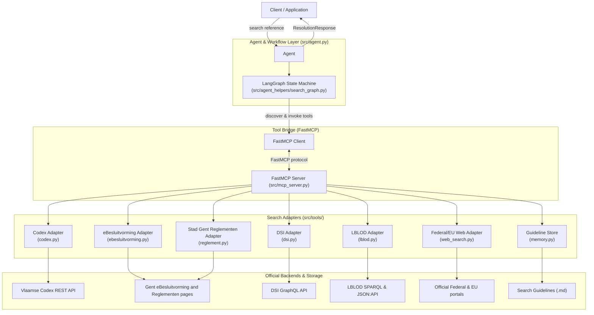
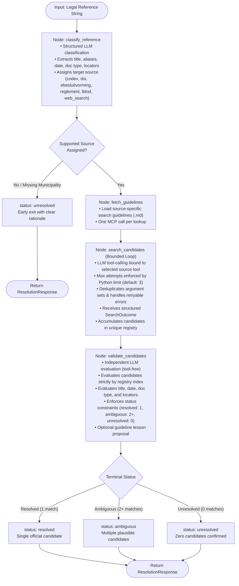

# ipi-legislation

> Automated resolution of Flemish and Belgian legal and municipal decision references against official, authoritative sources.

`ipi-legislation` is a specialized resolution service designed to resolve textual legal citations (such as decrees, laws, executive orders, circulars, and municipal council or college decisions) into their authoritative source documents, persistent official URLs, and structured metadata.

It uses a structured **LangGraph** orchestration workflow backed by a **FastMCP** (Model Context Protocol) tool layer and dedicated official search adapters.

---

## Table of Contents

- [Key Principles](#key-principles)
- [How It Works](#how-it-works)
  - [System Architecture](#system-architecture)
  - [Resolution Pipeline](#resolution-pipeline)
  - [Step-by-Step Workflow](#step-by-step-workflow)
- [Search Adapters & Sources](#search-adapters--sources)
- [Data Models & Contracts](#data-models--contracts)
- [Getting Started](#getting-started)
  - [Prerequisites](#prerequisites)
  - [Installation](#installation)
  - [Environment Configuration](#environment-configuration)
  - [Running the MCP Server](#running-the-mcp-server)
  - [Usage Example](#usage-example)
- [Configuration](#configuration)
- [Resolution Cache](#resolution-cache)
- [Mention Dataset Toolkit](#mention-dataset-toolkit)
- [Verification & Tests](#verification--tests)

---

## Key Principles

1. **Official Sources Are Authoritative**: Every result links back to the official primary publisher (Vlaamse Codex, eJustice, EUR-Lex, City of Ghent Reglementen/eBesluitvorming, or LBLOD) with official identifiers, URLs, and retrieval timestamps.
2. **Preserve Operational Uncertainty**: An upstream outage, network failure, or result-set truncation is never collapsed into an empty result (`0 matches`). If a backend fails or partially fails during fan-out, structured error details are returned and preserved.
3. **Preserve Genuine Ambiguity**: When a citation is temporally ambiguous or incomplete, the resolver marks the outcome as `ambiguous` with all plausible matches rather than guessing a single match.
4. **Separation of Reasoning and Execution**: LLM reasoning is separated into dedicated single-responsibility nodes (classify, search, validate). Tools are accessed via FastMCP with strict parameter validation and call limits.
5. **Token-Efficient Model Context**: URLs and timestamps are stripped before presenting candidates to the LLM during search and validation (as they do not establish legal identity), saving tokens and preventing hallucinated URLs.

---

## How It Works

### System Architecture

The service consists of four coordinated layers:
1. **Agent & LangGraph Workflow**: Manages state transitions, prompt injection, search iteration bounds, and candidate validation.
2. **FastMCP Server**: Exposes tool declarations and execution over standard MCP protocols.
3. **Source Adapters**: Standalone Python modules handling HTTP/REST and SPARQL queries to external endpoints.
4. **Resolution Cache**: Optionally stores resolved responses in append-only JSONL.



---

### Resolution Pipeline

Every search follows a deterministic, guarded sequence of operations:



---

### Step-by-Step Workflow

#### 1. Reference Classification (`classify_reference`)
- The reference string is classified via structured output into a normalized `ClassifiedReference` object.
- Extracts identifying facts: `title`, `aliases`, `document_type` (`decree`, `law`, `executive_order`, etc.), `document_date`, `identifier`, and citation locators (`article`, `paragraph`, `subsection`, `point`).
- Identifies local context: `municipality` and `governing_body`.
- Routes to one authoritative source (`codex`, `dsi`, `ebesluitvorming`, `reglement`, `lblod`, or `web_search`). Spatial planning instruments (RUP, BPA, APA, gewestplan) and all stedenbouwkundige verordeningen (SVO) / bouwverordeningen (BVO) route to `dsi`, while general municipal regulations (belastingen, retributies, subsidies, politie) route to `reglement`. If the reference lacks sufficient context (e.g., LBLOD query without a municipality) or references an unsupported source, execution routes directly to `END` with status `unresolved`.

#### 2. Source Guideline Loading (`fetch_guidelines`)
- Fetches the curated operational guideline markdown for the selected source via the FastMCP `fetch_guidelines` tool.
- Guidelines contain practical query formulation advice, quirks (such as stripping Dutch leading articles "De/Het" in Codex), and parameter requirements.

#### 3. Bounded Candidate Search (`search_candidates`)
- A bounded tool-calling loop where the LLM is bound **strictly** to the single search tool corresponding to the classified source (`search_codex`, `search_dsi`, `search_ebesluitvorming`, `search_reglement`, `search_lblod`, or `search_web`).
- The model may refine searches across multiple turns, up to `max_search_attempts` (default: `3`).
- **Safety guards**:
  - Python rejects calls to unauthorized tools.
  - Repeated identical search arguments are blocked without making redundant network calls (unless the prior attempt returned exclusively retryable source errors).
  - Returned candidates are deduplicated into a unique registry by `(source, doc_id)`.
  - Upstream request counts, completeness, truncation flags, and structured source errors are preserved in the execution trace.

#### 4. Independent Candidate Validation (`validate_candidates`)
- A separate, tool-free LLM step evaluates the accumulated candidates against the original reference and extracted locators.
- **Strict verification in Python**:
  - The model may only select candidate indices provided in the prompt.
  - Invariants are checked: `resolved` must select exactly 1 index; `ambiguous` must select 2 or more indices; `unresolved` must select 0 indices. Any out-of-bounds index or invariant violation automatically falls back to `unresolved`.
- The validator can propose an optional one-line `proposed_guideline_lesson` for offline operational review (live requests never modify guidelines directly).

#### 5. Response Construction
- Generates a `ResolutionResponse` containing the final status, selected candidates (with original URLs and timestamps intact), decision reason, attempt count, full execution trace, and any proposed lesson.

---

## Search Adapters & Sources

Each search adapter implements the `LegislationSearch` base class and returns a structured `SearchOutcome`:

| Source | Adapter Module | Guidelines | Coverage / Technology |
|---|---|---|---|
| **Vlaamse Codex** | [`src/tools/codex.py`](src/tools/codex.py) | [`codex.md`](src/tools/search-guidelines/codex.md) | Official Flemish and Belgian legislation (decrees, laws, executive orders, circulars). REST API with type and date filtering. |
| **DSI (Plannen en Verordeningen)** | [`src/tools/dsi.py`](src/tools/dsi.py) | [`dsi.md`](src/tools/search-guidelines/dsi.md) | Spatial planning instruments (gewestplan, RUP, BPA, APA, stedenbouwkundige verordeningen) across all Flemish municipalities. Public GraphQL API. |
| **City of Ghent** | [`src/tools/ebesluitvorming.py`](src/tools/ebesluitvorming.py) | [`ebesluitvorming.md`](src/tools/search-guidelines/ebesluitvorming.md) | Ghent municipal council (*Gemeenteraad*) and college (*College van Burgemeester en Schepenen*) decisions and agenda items. REST API. |
| **City of Ghent Reglementen** | [`src/tools/reglement.py`](src/tools/reglement.py) | [`reglement.md`](src/tools/search-guidelines/reglement.md) | Stad Gent municipal regulations, searchable by text and type. Public HTML listing. |
| **LBLOD / Lokaal Beslist** | [`src/tools/lblod.py`](src/tools/lblod.py) | [`lblod.md`](src/tools/search-guidelines/lblod.md) | Decisions from municipalities across Flanders published via Linked Open Data. SPARQL endpoint + JSON:API fallback. |
| **Federal & EU Web Search** | [`src/tools/web_search.py`](src/tools/web_search.py) | [`web_search.md`](src/tools/search-guidelines/web_search.md) | Belgian federal and European legislation via official publishers (eJustice, Belgisch Staatsblad, EUR-Lex). |

---

## Data Models & Contracts

### Core Response: `ResolutionResponse`

```python
class ResolutionResponse(BaseModel):
    reference: str                              # Original reference string
    status: ResolutionStatus                    # "resolved" | "ambiguous" | "unresolved"
    results: list[SearchResult]                 # Official matching documents
    reason: str                                 # Rationale for final decision
    attempt_count: int                          # Number of search attempts executed
    trace: list[AttemptTrace]                   # Structured execution trace of all calls
    proposed_guideline_lesson: str | None       # Optional search guideline lesson
```

### Search Result: `SearchResult`

```python
class SearchResult:
    title: str                                  # Official opschrift or title
    url: str                                    # Canonical URL to official document
    source: str                                 # "codex" | "ebesluitvorming" | "reglement" | "lblod"
    doc_id: str                                 # Source-specific unique identifier
    retrieved_at: datetime                      # Timestamp of search retrieval
    metadata: dict                              # Additional source metadata
```

### Adapter Outcome: `SearchOutcome`

Adapters do not return bare candidate lists. Every adapter returns a `SearchOutcome`:
- `candidates`: list of valid `SearchResult` records.
- `complete`: boolean indicating if all required backend requests succeeded.
- `truncated`: boolean indicating if an upstream result limit was hit.
- `total_available`: upstream source count if reported.
- `backend_request_count`: total HTTP/SPARQL queries executed.
- `errors`: list of `SearchError` objects (retaining backend, kind, message, retryability, and HTTP status).

---

## Getting Started

### Prerequisites

- Python `>= 3.11`
- Supported LLM credentials (e.g., Azure OpenAI, OpenAI, or any LangChain-supported provider)

### Installation

1. Clone the repository and navigate to the project directory:
   ```powershell
   git clone https://github.com/stefaanvercoutere/ipi-legislation.git
   cd ipi-legislation
   ```

2. Install dependencies:
   ```powershell
  pip install -r requirements.txt
   ```

### Environment Configuration

Copy `.env.example` to `.env` and fill in your model provider credentials:

```ini
# LangChain model selector (provider:model)
MODEL=azure_openai:gpt-4.1

# Azure OpenAI credentials (or standard OPENAI_API_KEY for OpenAI)
AZURE_OPENAI_API_KEY=your-api-key
AZURE_OPENAI_ENDPOINT=https://your-endpoint.openai.azure.com/
AZURE_OPENAI_DEPLOYMENT_NAME=your-deployment-name
OPENAI_API_VERSION=2025-03-01-preview
```

### Running the MCP Server

In a dedicated terminal or service process, start the FastMCP tool server:

```powershell
python -m src.mcp_server
```

The server listens by default at `http://127.0.0.1:8000/mcp`.

### Usage Example

Run a lookup from your application:

```python
import asyncio
from src.agent import Agent
from src.config import load_agent_config


async def main():
    # Load settings from config.json and environment
    config = load_agent_config()
    agent = Agent(config)

    # Resolve a legal citation
    response = await agent.search("Decreet over het lokaal bestuur van 22 december 2017")

    print(f"Status: {response.status}")
    print(f"Reason: {response.reason}")
    for candidate in response.results:
        print(f"- [{candidate.source}] {candidate.title}")
        print(f"  URL: {candidate.url}")


if __name__ == "__main__":
    asyncio.run(main())
```

---

## Configuration

Settings are managed in `config.json`:

```json
{
  "agent": {
    "mcp_server_url": "http://127.0.0.1:8000/mcp",
    "max_search_attempts": 3,
    "temperature": 0.0,
    "cache_path": "var/resolution-cache.jsonl"
  },
  "prompts": {}
}
```

- `mcp_server_url`: Endpoint for the FastMCP tool server.
- `max_search_attempts`: Upper bound of search queries allowed per lookup (1 to 3).
- `temperature`: Temperature for LLM calls (default: `0.0` for maximum reproducibility).
- `cache_path`: Optional path to append-only JSONL resolution records (set to `null` or omit to disable).
- `prompts`: Optional dictionary to override default prompts (`classify_reference`, `search_candidates`, `validate_candidates`) without altering Python code.

---

## Resolution Cache

When `cache_path` is configured, construct `ResolutionCacheService` with an
`ResolutionCacheWriter` for that path. The service calls the agent once and
appends only resolved responses with exactly one result and complete,
non-truncated, error-free source attempts. Each record stores the searched
mention and the canonical `doc_reference` separately; its key is derived from
the normalized document reference so different mentions of the same document
can share a future cache hit. Cache lookup is not performed yet.

---

## Mention Dataset Toolkit

The repository includes a self-contained dataset management sub-package in [`dataset/`](dataset/README.md):
- **Raw data collection**: Scripts to pull municipal agenda items and meeting data.
- **Mention extraction**: Specialized heuristics to extract legal citations from unstructured text.
- **Enrichment & Ground Truth**: Verification pipelines to benchmark and audit resolution accuracy against reference datasets.

---

## Verification & Tests

Run all unit and integration test suites:

```powershell
# Core agent, MCP server, search graph, and adapter tests
python -m unittest discover -s tests -v

# Dataset mention extraction and resolution tests
python -m unittest discover -s dataset/tests -v
```
